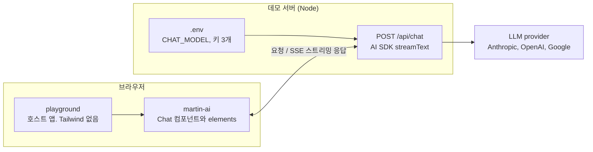

# AI 챗봇 모듈 검증 데모 스펙 (초안)

2026-11-17 · YongHoon

## 개요

이 데모는 "AI 챗봇 UI를 npm 패키지 하나로 만들어 여러 React SPA가 import해 쓴다"는 구조가 실제로 성립하는지 확인하기 위한 것입니다. 실서비스는 이 결과를 참고해 별도로 설계하므로, 여기서는 확인에 필요한 최소한만 만듭니다.

구성은 라이브러리 패키지 1개(`martin-ai`)와 앱 2개입니다. 앱은 호스트 역할을 하는 SPA와 LLM을 호출하는 최소 서버입니다. DB, 인증, 배포 파이프라인은 두지 않습니다.

판단이 갈리는 지점에서는 더 단순한 쪽을 고릅니다.

## 검증 목표

데모가 답해야 할 질문은 다섯 가지이고, 다섯 개가 모두 통과하면 데모는 끝납니다.

| # | 확인할 것 | 통과 기준 |
| --- | --- | --- |
| V1 | npm 패키지 형태로 소비할 수 있는가 | `pnpm pack`으로 만든 tarball을 설치한 SPA에서 import 두 줄(컴포넌트, CSS)로 채팅 UI가 뜬다. 타입도 함께 잡힌다 |
| V2 | 호스트에 종속되지 않는가 | Tailwind, shadcn, 라우터, 상태관리 라이브러리가 없는 React 19 + Vite 앱에서 동작한다 |
| V3 | AI SDK로 스트리밍 채팅이 되는가 | 응답이 생성되는 대로 표시되고, 중단·오류 표시·도구 호출 1종 표시가 된다. Anthropic, OpenAI, Google 모델에서 각각 확인한다 |
| V4 | AI Elements를 re-export해 쓸 수 있는가 | 호스트가 `martin-ai``/elements`의 조각만으로 기본 `<Chat />`과 다른 레이아웃을 조립한다 |
| V5 | pnpm만으로 모노레포가 굴러가는가 | Turborepo 없이 `pnpm dev`, `pnpm build` 두 명령으로 개발과 빌드가 된다 |

## 범위

채팅 한 화면이 동작하는 데 필요한 것까지만 만들고, 운영에 필요한 것은 모두 뺍니다.

### 포함

- `martin-ai` 패키지: `<Chat />` 컴포넌트, AI Elements re-export, 컴파일된 CSS 한 파일
- 메시지 표시: 텍스트(마크다운), 추론 과정, 도구 호출과 그 결과
- 입력: 전송, 응답 중단, 오류 표시
- 데모 서버: 채팅 엔드포인트 하나, 샘플 도구 1개, 서버 설정으로 고르는 Anthropic·OpenAI·Google 모델
- 데모 앱: 기본형 화면과 조립형 화면

### 제외

- 대화 저장과 세션 목록. 새로고침하면 대화가 사라집니다.
- 인증, 사용자 구분, 사용량 제한
- npm 레지스트리 배포, 버전 관리, CI
- 스타일 격리, 테마 커스터마이즈, 다크 모드
- React 18과 SSR 환경(Next.js 등) 지원
- 파일 첨부, 모델 선택기, 대화 분기 등 그 밖의 AI Elements 패턴
- 다국어. UI 문구는 한국어로 고정합니다.
- 자동화 테스트. 타입 검사, 빌드, 수동 체크리스트로 대신합니다.
- 백엔드 플랫폼(Supabase 등)과 작업 실행기(Turborepo)

## 구조

저장소는 라이브러리 패키지 1개와 앱 2개로 이루어진 pnpm 워크스페이스입니다.

```
.
├─ apps/
│  ├─ playground/           호스트 역할의 SPA (Vite + React 19, Tailwind 없음)
│  └─ server/               채팅 엔드포인트 하나 (Hono, Node)
├─ packages/
│  └─ martin-ai/            유일한 라이브러리 패키지
│     ├─ components.json    shadcn CLI 설정
│     ├─ tsdown.config.ts
│     └─ src/
│        ├─ components/ui/  shadcn/ui 컴포넌트. CLI가 관리하고 직접 고치지 않음
│        ├─ elements/       AI Elements 패턴. 문서의 코드를 복사해 우리가 관리
│        ├─ hooks/  lib/    CLI가 함께 추가하는 훅과 유틸
│        ├─ chat.tsx        <Chat />. useChat과 elements를 연결
│        ├─ index.ts        공개 API
│        └─ styles.css      Tailwind 입력 파일
├─ package.json             루트 스크립트 (dev, build, typecheck)
└─ pnpm-workspace.yaml      워크스페이스 목록과 allowBuilds
```



브라우저는 LLM 키를 갖지 않습니다. `martin-ai`는 `/api/chat`만 호출하고, 키는 서버의 환경변수에만 둡니다.

## 패키지 스펙: `martin-ai`

호스트가 설치하는 것은 이 패키지 하나이고, 쓰는 방법은 import 두 줄입니다.

```tsx
import { Chat } from "martin-ai";
import "martin-ai/styles.css";

<Chat api="/api/chat" />
```

### 공개 API

| 진입점 | 내보내는 것 |
| --- | --- |
| `martin-ai` | `Chat` 컴포넌트와 타입. AI SDK의 `useChat`, `DefaultChatTransport`도 그대로 다시 내보냄 |
| `martin-ai``/elements` | AI Elements 패턴과 그 밑단의 shadcn/ui 컴포넌트 |
| `martin-ai``/styles.css` | 컴파일된 CSS 한 파일 |

`Chat`의 props는 네 개로 제한합니다.

| prop | 타입 | 기본값 | 용도 |
| --- | --- | --- | --- |
| `api` | `string` | `"/api/chat"` | 채팅 엔드포인트 주소 |
| `transport` | `ChatTransport` | 없음 | 주어지면 `api` 대신 사용 |
| `placeholder` | `string` | `"메시지를 입력하세요"` | 입력창 안내 문구 |
| `className` | `string` | 없음 | 루트 요소에 덧붙일 클래스 |

### 화면 구성과 AI Elements

AI Elements는 설치하는 패키지가 아니라 문서의 코드를 복사해 쓰는 패턴입니다. 그래서 밑단 컴포넌트만 CLI로 받고, 패턴은 `src/elements/`에 직접 둡니다.

| 화면 요소 | 패턴 | 밑단 컴포넌트 |
| --- | --- | --- |
| 대화 스레드 | [Chat](https://ui.shadcn.com/docs/ai-elements/base/chat) | Message Scroller, Message, Bubble |
| 답변 본문 | [Message](https://ui.shadcn.com/docs/ai-elements/base/message) | Streamdown(마크다운), Code Block(코드 펜스) |
| 입력창 | [Prompt Input](https://ui.shadcn.com/docs/ai-elements/base/prompt-input) | Input Group |
| 추론 과정 | [Reasoning](https://ui.shadcn.com/docs/ai-elements/base/reasoning) | Trace |
| 도구 호출 | [Tool](https://ui.shadcn.com/docs/ai-elements/base/tool) | Trace, Code Block |

```bash
pnpm dlx shadcn@latest add message-scroller message bubble input-group trace code-block
```

- 패턴에서 선택 사항인 부분은 뺍니다. 메시지 액션(복사, 재시도)과 그 Tooltip, 입력창의 첨부와 모델 메뉴가 해당합니다.
- `components/ui/`는 고치지 않습니다. 업스트림이 바뀌면 `shadcn add <이름> --overwrite`로 다시 받습니다.
- shadcn 설정은 [수동 설치 절차](https://ui.shadcn.com/docs/installation/manual)를 따릅니다. 프리미티브는 Base UI, 스타일은 `base-nova`입니다.
- 내부 import 별칭은 `package.json#imports`의 `#components/*`, `#lib/*`, `#hooks/*`를 씁니다.

### 스타일

- 패키지 빌드 때 Tailwind v4로 `dist/styles.css` 한 파일을 컴파일합니다. 호스트에는 Tailwind가 필요 없습니다.
- 입력 파일은 `tailwindcss`, `tw-animate-css`, `shadcn/tailwind.css`를 import하고, shadcn 테마 토큰을 `:root`에 정의합니다.
- Streamdown의 클래스가 CSS에 포함되도록 `@source "../node_modules/streamdown/dist/*.js";`를 추가합니다.
- 라이트 테마만 다룹니다.
- 이 CSS는 Tailwind의 전역 리셋을 포함하므로 호스트의 기본 요소 스타일을 바꿉니다. 격리는 이번 범위가 아닙니다.

### 의존성

| 구분 | 패키지 |
| --- | --- |
| peerDependencies | `react`, `react-dom` (19) |
| dependencies | `ai` 7, `@ai-sdk/react` 4, `streamdown`, `cn`, `class-variance-authority`, `lucide-react`, 그리고 CLI가 컴포넌트와 함께 추가하는 것(`@base-ui/react`, `shiki` 등) |
| devDependencies | `tsdown`, `tailwindcss`, `@tailwindcss/cli`, `tw-animate-css`, `shadcn`, `typescript` |

`ai`와 `@ai-sdk/react`를 dependencies에 두는 것은 호스트의 설치를 한 줄로 줄이기 위한 데모용 선택입니다.

### 빌드

- `tsdown`이 `src/index.ts`와 `src/elements/index.ts`를 ESM과 `.d.ts`로 묶습니다. dependencies는 번들에 넣지 않습니다.
- `@tailwindcss/cli`가 `src/styles.css`를 `dist/styles.css`로 컴파일합니다.
- 두 도구가 `dist`를 함께 쓰므로 tsdown의 `clean`은 끕니다.

```json
{
  "name": "martin-ai",
  "type": "module",
  "files": ["dist"],
  "sideEffects": ["**/*.css"],
  "exports": {
    ".": { "types": "./dist/index.d.ts", "import": "./dist/index.js" },
    "./elements": { "types": "./dist/elements.d.ts", "import": "./dist/elements.js" },
    "./styles.css": "./dist/styles.css"
  },
  "scripts": {
    "build": "tsdown && tailwindcss -i src/styles.css -o dist/styles.css --minify",
    "dev:js": "tsdown --watch",
    "dev:css": "tailwindcss -i src/styles.css -o dist/styles.css --watch",
    "dev": "pnpm run \"/^dev:.*/\"",
    "typecheck": "tsc --noEmit"
  }
}
```

## 데모 서버: `apps/server`

서버는 LLM 키를 보관하고 응답을 스트리밍하는 엔드포인트 하나만 가집니다. Hono(Node)와 AI SDK 7로 작성하며 파일 하나로 끝냅니다.

| 항목 | 내용 |
| --- | --- |
| 엔드포인트 | `POST /api/chat` |
| 요청 | `useChat`이 보내는 JSON 그대로. `messages` 배열을 사용 |
| 응답 | AI SDK UI message stream (`text/event-stream`) |
| 포트 | 8787 (`PORT`로 변경) |

처리 순서는 세 단계입니다.

1. `convertToModelMessages`로 요청의 메시지를 모델 입력으로 바꿉니다.
2. `streamText`를 호출합니다. 시스템 지시문 1개, 도구 1개, 최대 5단계(`isStepCount(5)`)로 제한합니다.
3. `toUIMessageStream`과 `createUIMessageStreamResponse`로 스트림을 그대로 응답합니다.

모델은 서버 설정으로 고릅니다. provider 패키지 세 개를 AI SDK의 provider registry에 등록해 두고, `CHAT_MODEL`에 `회사:모델명` 형식의 문자열을 적습니다.

| 회사 | 패키지 | 키 환경변수 | `CHAT_MODEL` 접두사 |
| --- | --- | --- | --- |
| Anthropic | `@ai-sdk/anthropic` | `ANTHROPIC_API_KEY` | `anthropic:` |
| OpenAI | `@ai-sdk/openai` | `OPENAI_API_KEY` | `openai:` |
| Google | `@ai-sdk/google` | `GOOGLE_GENERATIVE_AI_API_KEY` | `google:` |

환경변수는 `apps/server/.env`에 두고 git에서 제외합니다. 아래 모델 ID는 예시입니다.

```
ANTHROPIC_API_KEY=...
OPENAI_API_KEY=...
GOOGLE_GENERATIVE_AI_API_KEY=...
CHAT_MODEL=anthropic:claude-sonnet-5-5
```

그 밖의 규칙은 다섯 가지입니다.

- 모델을 바꾸려면 `CHAT_MODEL`을 고치고 서버를 다시 띄웁니다. 화면에서 모델을 고르는 기능은 두지 않습니다.
- `CHAT_MODEL`이 없으면 고정된 문장을 스트리밍하는 대본 모드로 동작합니다(AI SDK의 테스트용 mock 모델 사용). 키 없이도 화면을 시연할 수 있고, 도구 호출과 추론 표시는 실제 모델로 확인합니다.
- 샘플 도구는 `getCurrentTime` 하나입니다. 외부 호출 없이 서버 시각을 돌려주며, 도구 호출 UI를 확인하는 용도입니다.
- 오류의 원인은 서버 로그에만 남습니다. 클라이언트에는 `An error occurred.`라는 일반 문구만 전달됩니다.
- CORS 설정은 두지 않습니다. playground의 개발 서버가 `/api`를 이 서버로 프록시합니다.

## 데모 앱: `apps/playground`

playground는 아무것도 갖추지 않은 호스트 역할을 합니다. Vite, React 19, TypeScript만 쓰고 Tailwind, shadcn, 라우터, 상태관리 라이브러리를 넣지 않습니다.

| 화면 | 구성 | 확인하는 것 |
| --- | --- | --- |
| 기본형 | `<Chat />` 한 줄 | V1, V2, V3 |
| 조립형 | `martin-ai``/elements`의 조각과 `useChat`으로 만든 좁은 사이드 패널 | V4 |

- 의존성은 `martin-ai`(`workspace:*`), `react`, `react-dom` 세 개입니다.
- 두 화면은 라우터 없이 탭 상태로 전환합니다.
- 호스트 자체의 헤더와 본문에는 평범한 CSS를 몇 줄 둡니다. 패키지 CSS가 호스트 스타일에 주는 영향을 눈으로 보기 위해서입니다.
- 개발 서버는 `/api`를 `http://localhost:8787`로 프록시합니다.

## 개발 환경과 명령

필요한 것은 Node.js와 pnpm뿐이고, 작업 실행기는 쓰지 않습니다.

| 도구 | 버전 | 근거 |
| --- | --- | --- |
| Node.js | 22.18 이상의 22.x 또는 24.11 이상 | AI SDK 7은 22 이상, tsdown은 22.18+, 24.11+, 26+ 중 하나를 요구 |
| pnpm | 12 | 워크스페이스와 스크립트 실행 |

| 명령 | 하는 일 |
| --- | --- |
| `pnpm install` | 의존성 설치 |
| `pnpm dev` | 패키지를 한 번 빌드한 뒤 패키지 watch, 서버(8787), playground(5173)를 함께 실행 |
| `pnpm build` | 의존 순서대로 전체 빌드 |
| `pnpm typecheck` | 전체 타입 검사 |

루트 `package.json`의 스크립트는 세 줄입니다.

```json
{
  "scripts": {
    "dev": "pnpm --filter martin-ai build && pnpm -r --parallel run dev",
    "build": "pnpm -r run build",
    "typecheck": "pnpm -r run typecheck"
  }
}
```

`pnpm-workspace.yaml`에는 워크스페이스 목록과 `allowBuilds`를 둡니다. pnpm 12는 의존성의 설치 스크립트를 기본으로 막아서, 이 목록이 없으면 `pnpm install`이 `ERR_PNPM_IGNORED_BUILDS` 오류로 끝납니다.

```yaml
packages:
  - "packages/*"
  - "apps/*"
allowBuilds:
  esbuild: true
  "@parcel/watcher": true
```

## 검증 체크리스트

아래 항목을 모두 체크하면 데모의 목적을 달성한 것입니다.

### V1. npm 패키지 형태

- [ ] `packages/``martin-ai`에서 `pnpm pack`으로 tarball을 만든다
- [ ] 워크스페이스 밖의 새 Vite 앱에 tarball을 설치한다
- [ ] import 두 줄로 채팅 UI가 뜨고 `tsc --noEmit`이 통과한다

### V2. 호스트 비종속

- [ ] playground의 의존성에 Tailwind, shadcn, 라우터, 상태관리 라이브러리가 없다
- [ ] 그 상태에서 채팅 UI의 스타일이 온전히 적용된다
- [ ] 호스트 자체 요소(헤더, 본문)에 생긴 스타일 변화를 기록한다

### V3. 스트리밍 채팅

- [ ] 답변이 생성되는 대로 이어서 표시된다
- [ ] 응답 도중 중단 버튼으로 멈출 수 있다
- [ ] 서버를 끈 상태에서 전송하면 오류 문구가 보인다
- [ ] 마크다운(목록, 굵게, 코드 펜스)이 렌더링된다
- [ ] 현재 시각을 물으면 `getCurrentTime` 호출과 그 결과가 표시된다
- [ ] 추론을 내보내는 모델에서 추론 과정이 표시된다
- [ ] `CHAT_MODEL`을 Anthropic, OpenAI, Google 모델로 바꿔 가며 위 항목을 다시 확인한다

### V4. AI Elements re-export

- [ ] 조립형 화면이 `martin-ai`와 `martin-ai``/elements`만 import한다
- [ ] 기본형과 다른 레이아웃에서 같은 대화 기능이 동작한다

### V5. pnpm 모노레포

- [ ] 새로 clone한 저장소에서 `pnpm install`과 `pnpm dev`만으로 화면이 뜬다
- [ ] `pnpm build`와 `pnpm typecheck`가 통과한다
- [ ] 패키지 소스를 고치면 다시 빌드되어 playground에 반영된다
