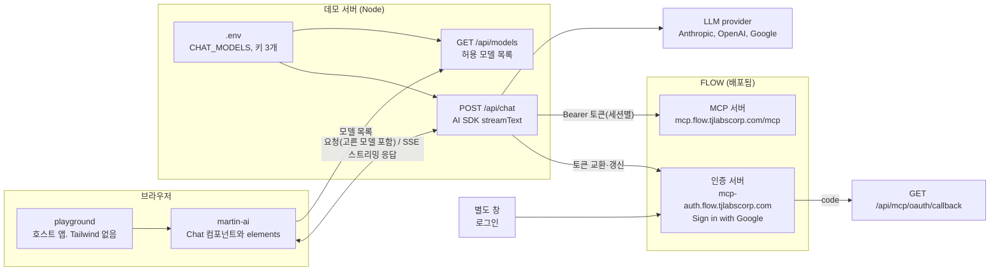

# AI 챗봇 모듈 검증 데모 스펙 (초안)

2026-11-17 · YongHoon

## 개요

이 데모는 "AI 챗봇 UI를 npm 패키지 하나로 만들어 여러 React SPA가 import해 쓴다"는 구조가 실제로 성립하는지 확인하기 위한 것입니다. 실서비스는 이 결과를 참고해 별도로 설계하므로, 여기서는 확인에 필요한 최소한만 만듭니다.

구성은 라이브러리 패키지 1개(`martin-ai`)와 앱 2개입니다. 앱은 호스트 역할을 하는 SPA와 LLM을 호출하는 최소 서버입니다. DB, 인증, 배포 파이프라인은 두지 않습니다.

판단이 갈리는 지점에서는 더 단순한 쪽을 고릅니다.

## 검증 목표

데모가 답해야 할 질문은 여섯 가지이고, 여섯 개가 모두 통과하면 데모는 끝납니다.

| # | 확인할 것 | 통과 기준 |
| --- | --- | --- |
| V1 | npm 패키지 형태로 소비할 수 있는가 | `pnpm pack`으로 만든 tarball을 설치한 SPA에서 import 두 줄(컴포넌트, CSS)로 채팅 UI가 뜬다. 타입도 함께 잡힌다 |
| V2 | 호스트에 종속되지 않는가 | Tailwind, shadcn, 라우터, 상태관리 라이브러리가 없는 React 19 + Vite 앱에서 동작한다 |
| V3 | AI SDK로 스트리밍 채팅이 되는가 | 응답이 생성되는 대로 표시되고, 중단·오류 표시·도구 호출 1종 표시가 된다. Anthropic, OpenAI, Google 모델에서 각각 확인한다 |
| V4 | AI Elements를 re-export해 쓸 수 있는가 | 호스트가 `martin-ai``/elements`의 조각만으로 기본 `<Chat />`과 다른 레이아웃을 조립한다 |
| V5 | pnpm만으로 모노레포가 굴러가는가 | Turborepo 없이 `pnpm dev`, `pnpm build` 두 명령으로 개발과 빌드가 된다 |
| V6 | 인증이 필요한 MCP를 백엔드에 정적으로 붙일 수 있는가 | FLOW에 연결하지 않은 브라우저에는 연결 버튼이 보이고, 별도 창에서 Sign in with Google을 마치면 같은 질문에 FLOW 도구로 답한다. 토큰은 서버 메모리에만 있어 브라우저에 노출되지 않고, 서버를 다시 띄우면 모든 연결이 초기화된다 |

## 범위

채팅 한 화면이 동작하는 데 필요한 것까지만 만들고, 운영에 필요한 것은 모두 뺍니다.

### 포함

- `martin-ai` 패키지: `<Chat />` 컴포넌트, AI Elements re-export, 컴파일된 CSS 한 파일
- 메시지 표시: 텍스트(마크다운), 추론 과정, 도구 호출과 그 결과
- 입력: 전송, 응답 중단, 오류 표시, 모델 선택, 사고 수준(effort) 선택
- 데모 서버: 채팅 엔드포인트, 모델 목록 엔드포인트, 샘플 도구 1개. 서버 설정으로 허용한 Anthropic·OpenAI·Google 모델 가운데 화면에서 고른 모델로 응답
- MCP: 백엔드에 정적으로 붙인 FLOW MCP 서버 1개. 사용자별 FLOW 로그인(Sign in with Google)과 그 토큰의 서버 메모리 보관
- 데모 앱: 기본형 화면과 조립형 화면

### 제외

- 대화 저장과 세션 목록. 새로고침하면 대화가 사라집니다.
- 앱 자체의 로그인, 사용자 계정, 사용량 제한. FLOW 연결을 위해 브라우저마다 익명 세션 쿠키 하나만 둡니다.
- 토큰과 세션의 영속 저장, 브라우저 쪽 토큰 저장. 서버를 다시 띄우면 모든 FLOW 연결이 초기화되고 다시 연결해야 합니다.
- FLOW 연결 해제 기능. 연결을 끊으려면 서버를 다시 띄웁니다.
- 화면에서 MCP 서버를 추가하거나 빼는 기능
- npm 레지스트리 배포, 버전 관리, CI
- 스타일 격리, 테마 커스터마이즈, 다크 모드
- React 18과 SSR 환경(Next.js 등) 지원
- 파일 첨부, 대화 분기 등 그 밖의 AI Elements 패턴
- 서버가 허용하지 않은 모델의 사용. 화면에서는 서버 목록에 있는 모델만 고를 수 있습니다.
- 다국어. UI 문구는 한국어로 고정합니다.
- 자동화 테스트. 타입 검사, 빌드, 수동 체크리스트로 대신합니다.
- 백엔드 플랫폼(Supabase 등)과 작업 실행기(Turborepo)

## 구조

저장소는 라이브러리 패키지 1개와 앱 2개로 이루어진 pnpm 워크스페이스입니다.

```
.
├─ apps/
│  ├─ playground/           호스트 역할의 SPA (Vite + React 19, Tailwind 없음)
│  └─ server/               채팅·모델 목록·FLOW 인증 콜백 엔드포인트 (Hono, Node)
├─ packages/
│  └─ martin-ai/            유일한 라이브러리 패키지
│     ├─ components.json    shadcn CLI 설정
│     ├─ tsdown.config.ts
│     └─ src/
│        ├─ components/ui/  shadcn/ui 컴포넌트. CLI가 관리하고 직접 고치지 않음
│        ├─ elements/       AI Elements 패턴. 문서의 코드를 복사해 우리가 관리
│        ├─ hooks/  lib/    CLI가 함께 추가하는 훅과 유틸
│        ├─ chat.tsx        <Chat />. useChat과 elements를 연결
│        ├─ index.ts        공개 API
│        └─ styles.css      Tailwind 입력 파일
├─ package.json             루트 스크립트 (dev, build, typecheck)
└─ pnpm-workspace.yaml      워크스페이스 목록과 allowBuilds
```



브라우저는 LLM 키와 FLOW 토큰을 갖지 않습니다. `martin-ai`는 `/api/models`와 `/api/chat`만 호출하고, 키는 서버의 환경변수에, FLOW 토큰은 서버 메모리에만 둡니다. 브라우저가 FLOW와 직접 주고받는 것은 별도 창에서의 로그인뿐입니다.

## 패키지 스펙: `martin-ai`

호스트가 설치하는 것은 이 패키지 하나이고, 쓰는 방법은 import 두 줄입니다.

```tsx
import { Chat } from "martin-ai";
import "martin-ai/styles.css";

<Chat api="/api/chat" />
```

### 공개 API

| 진입점 | 내보내는 것 |
| --- | --- |
| `martin-ai` | `Chat` 컴포넌트와 타입, 모델·사고 수준 목록을 읽고 고른 값을 들고 있는 `useChatModels` 훅, 도구 인증(로그인) 완료 알림을 받는 `useAuthComplete` 훅. AI SDK의 `useChat`, `DefaultChatTransport`도 그대로 다시 내보냄 |
| `martin-ai``/elements` | AI Elements 패턴과 그 밑단의 shadcn/ui 컴포넌트 |
| `martin-ai``/styles.css` | 컴파일된 CSS 한 파일 |

`Chat`의 props는 다섯 개로 제한합니다.

| prop | 타입 | 기본값 | 용도 |
| --- | --- | --- | --- |
| `api` | `string` | `"/api/chat"` | 채팅 엔드포인트 주소 |
| `modelsApi` | `string` | `"/api/models"` | 모델·사고 수준 목록 엔드포인트 주소. 모델이 2개 이상이면 모델 메뉴를, 사고 수준 목록이 있으면 사고 수준 메뉴를 입력창에 보임 |
| `transport` | `ChatTransport` | 없음 | 주어지면 `api` 대신 사용 |
| `placeholder` | `string` | `"메시지를 입력하세요"` | 입력창 안내 문구 |
| `className` | `string` | 없음 | 루트 요소에 덧붙일 클래스 |

### 화면 구성과 AI Elements

AI Elements는 설치하는 패키지가 아니라 문서의 코드를 복사해 쓰는 패턴입니다. 그래서 밑단 컴포넌트만 CLI로 받고, 패턴은 `src/elements/`에 직접 둡니다.

| 화면 요소 | 패턴 | 밑단 컴포넌트 |
| --- | --- | --- |
| 대화 스레드 | [Chat](https://ui.shadcn.com/docs/ai-elements/base/chat) | Message Scroller, Message, Bubble |
| 답변 본문 | [Message](https://ui.shadcn.com/docs/ai-elements/base/message) | Streamdown(마크다운), Code Block(코드 펜스) |
| 입력창 | [Prompt Input](https://ui.shadcn.com/docs/ai-elements/base/prompt-input) | Input Group |
| 모델·사고 수준 선택 | [Model Selector](https://ui.shadcn.com/docs/ai-elements/base/model-selector) (모델 메뉴와 Effort 메뉴) | Dropdown Menu, Input Group |
| 추론 과정 | [Reasoning](https://ui.shadcn.com/docs/ai-elements/base/reasoning) | Trace |
| 도구 호출 | [Tool](https://ui.shadcn.com/docs/ai-elements/base/tool) | Trace, Code Block |

```bash
pnpm dlx shadcn@latest add message-scroller message bubble input-group trace code-block dropdown-menu
```

- 패턴에서 선택 사항인 부분은 뺍니다. 메시지 액션(복사, 재시도)과 그 Tooltip, 입력창의 첨부가 해당합니다.
- 모델 메뉴의 버튼과 회사 이름 앞에 provider 로고를 보입니다. Anthropic과 Google 로고는 Simple Icons(프로젝트 라이선스 CC0)의 SVG 경로를 `src/elements/provider-logo.tsx`에 그대로 둡니다. 패키지는 추가하지 않습니다. 로고가 없는 provider(OpenAI 등)는 일반 아이콘으로 보입니다. 로고는 각 회사의 상표이므로 실서비스에서는 브랜드 가이드라인을 따로 확인합니다.
- `components/ui/`는 고치지 않습니다. 업스트림이 바뀌면 `shadcn add <이름> --overwrite`로 다시 받습니다.
- shadcn 설정은 [수동 설치 절차](https://ui.shadcn.com/docs/installation/manual)를 따릅니다. 프리미티브는 Base UI, 스타일은 `base-nova`입니다.
- 내부 import 별칭은 `package.json#imports`의 `#components/*`, `#lib/*`, `#hooks/*`를 씁니다.

### 스타일

- 패키지 빌드 때 Tailwind v4로 `dist/styles.css` 한 파일을 컴파일합니다. 호스트에는 Tailwind가 필요 없습니다.
- 입력 파일은 `tailwindcss`, `tw-animate-css`, `shadcn/tailwind.css`를 import하고, shadcn 테마 토큰을 `:root`에 정의합니다.
- Streamdown의 클래스가 CSS에 포함되도록 `@source "../node_modules/streamdown/dist/*.js";`를 추가합니다.
- 라이트 테마만 다룹니다.
- 이 CSS는 Tailwind의 전역 리셋을 포함하므로 호스트의 기본 요소 스타일을 바꿉니다. 격리는 이번 범위가 아닙니다.

### 의존성

| 구분 | 패키지 |
| --- | --- |
| peerDependencies | `react`, `react-dom` (19) |
| dependencies | `ai` 7, `@ai-sdk/react` 4, `streamdown`, `cn`, `class-variance-authority`, `lucide-react`, 그리고 CLI가 컴포넌트와 함께 추가하는 것(`@base-ui/react`, `shiki` 등) |
| devDependencies | `tsdown`, `tailwindcss`, `@tailwindcss/cli`, `tw-animate-css`, `shadcn`, `typescript` |

`ai`와 `@ai-sdk/react`를 dependencies에 두는 것은 호스트의 설치를 한 줄로 줄이기 위한 데모용 선택입니다.

### 빌드

- `tsdown`이 `src/index.ts`와 `src/elements/index.ts`를 ESM과 `.d.ts`로 묶습니다. dependencies는 번들에 넣지 않습니다.
- `@tailwindcss/cli`가 `src/styles.css`를 `dist/styles.css`로 컴파일합니다.
- 두 도구가 `dist`를 함께 쓰므로 tsdown의 `clean`은 끕니다.

```json
{
  "name": "martin-ai",
  "type": "module",
  "files": ["dist"],
  "sideEffects": ["**/*.css"],
  "exports": {
    ".": { "types": "./dist/index.d.ts", "import": "./dist/index.js" },
    "./elements": { "types": "./dist/elements.d.ts", "import": "./dist/elements.js" },
    "./styles.css": "./dist/styles.css"
  },
  "scripts": {
    "build": "tsdown && tailwindcss -i src/styles.css -o dist/styles.css --minify",
    "dev:js": "tsdown --watch",
    "dev:css": "tailwindcss -i src/styles.css -o dist/styles.css --watch",
    "dev": "pnpm run \"/^dev:.*/\"",
    "typecheck": "tsc --noEmit"
  }
}
```

## 데모 서버: `apps/server`

서버는 LLM 키를 보관하고, 허용 모델 목록을 알려 주는 엔드포인트와 응답을 스트리밍하는 엔드포인트, FLOW 로그인 콜백을 가집니다. Hono(Node)와 AI SDK 7로 작성하며, 채팅 처리(`src/index.ts`), FLOW MCP 연결(`src/flow-mcp.ts`), 클라이언트 오류 문구(`src/client-error.ts`) 세 파일로 나눕니다.

| 항목 | 내용 |
| --- | --- |
| 엔드포인트 | `GET /api/models`, `POST /api/chat`, `GET /api/mcp/oauth/callback` |
| `GET /api/models` 응답 | `{ models: [{ id, provider, name }], defaultModel, efforts }`. `efforts`는 고를 수 있는 사고 수준(`low`, `medium`, `high`, `xhigh`, `max`). 대본 모드에서는 `models`와 `efforts`가 빈 배열이고 `defaultModel`이 `null` |
| `POST /api/chat` 요청 | `useChat`이 보내는 JSON 그대로. `messages` 배열과, 화면에서 고른 모델 ID인 `model`(선택), 사고 수준인 `effort`(선택)를 사용 |
| `POST /api/chat` 응답 | AI SDK UI message stream (`text/event-stream`) |
| 포트 | 8787 (`PORT`로 변경) |

처리 순서는 네 단계입니다.

1. 요청의 `model`과 `effort`를 허용 목록과 대조합니다. `model`이 없으면 기본 모델을, `effort`가 없으면 모델의 기본 사고 수준을 쓰고, 목록에 없는 값이면 `400`으로 거절합니다.
2. `convertToModelMessages`로 요청의 메시지를 모델 입력으로 바꿉니다. 응답 도중 중단하거나 끊겨 결과 없이 남은 도구 호출은 빼고 바꿉니다(`ignoreIncompleteToolCalls`). 그대로 두면 AI SDK가 `MissingToolResultsError`로 모델 호출을 거절해, 그 대화의 이후 요청이 모두 실패합니다. 도구 결과는 실행한 턴과 같은 형태로 다시 만들도록 도구 정보를 함께 넘기고, FLOW에 연결되지 않은 턴에도 FLOW 도구 결과가 같은 형태가 되도록 MCP 결과 변환(`mcpToModelOutput`과 같은 로직)을 함께 넘깁니다.
3. `streamText`를 호출합니다. 시스템 지시문 1개, 샘플 도구 1개와 이 세션의 FLOW 도구, 최대 5단계(`isStepCount(5)`)로 제한합니다. FLOW 연결은 응답이 끝나면 닫습니다.
4. `toUIMessageStream`과 `createUIMessageStreamResponse`로 스트림을 그대로 응답합니다.

고를 수 있는 모델은 서버 설정으로 정합니다. provider 패키지 세 개를 AI SDK의 provider registry에 등록해 두고, `CHAT_MODELS`에 `회사:모델명` 형식의 문자열을 쉼표로 나열합니다. 첫 번째가 기본 모델입니다.

| 회사 | 패키지 | 키 환경변수 | `CHAT_MODELS` 접두사 |
| --- | --- | --- | --- |
| Anthropic | `@ai-sdk/anthropic` | `ANTHROPIC_API_KEY` | `anthropic:` |
| OpenAI | `@ai-sdk/openai` | `OPENAI_API_KEY` | `openai:` |
| Google | `@ai-sdk/google` | `GOOGLE_GENERATIVE_AI_API_KEY` | `google:` |

환경변수는 `apps/server/.env`에 두고 git에서 제외합니다. 아래 모델 ID는 예시입니다.

```
ANTHROPIC_API_KEY=...
OPENAI_API_KEY=...
GOOGLE_GENERATIVE_AI_API_KEY=...
CHAT_MODELS=anthropic:claude-sonnet-5-5,openai:gpt-5,google:gemini-2.5-pro
```

그 밖의 규칙은 일곱 가지입니다.

- Claude의 사고(thinking) 블록은 그것을 만든 대화 기록에 묶여 있어, 도구 목록이나 이전 기록이 바뀌면 API가 `Invalid signature in thinking block`으로 요청을 거절합니다. 이 앱은 FLOW 연결 상태에 따라 도구 목록이 바뀌므로(연결 전 `connectFlow`, 연결 후 FLOW 도구), Anthropic 요청에 `thinking.blockBinding.prefixMismatchBehavior: "drop_block"`을 넣어 어긋난 사고 블록은 버리고 요청을 진행합니다. AI SDK가 필요한 베타 헤더(`thinking-binding-controls-2026-08-01`)를 자동으로 붙입니다.
- 화면에서는 `CHAT_MODELS`에 있는 모델만 고를 수 있습니다. 목록을 바꾸려면 `CHAT_MODELS`를 고치고 서버를 다시 띄웁니다. 클라이언트는 모델 ID만 보내며, 어떤 회사의 어떤 모델이 허용되는지는 서버가 정합니다.
- 사고 수준(`effort`)도 서버가 정한 목록(`low`, `medium`, `high`, `xhigh`, `max`) 안에서만 고릅니다. 고르지 않으면 보내지 않고 모델의 기본값을 씁니다(예: Claude Opus 5.5와 Haiku 5.5는 `medium`, Sonnet 5.5는 `high`). provider마다 받는 옵션이 달라 서버가 바꿔 넘깁니다. Anthropic은 `effort`, OpenAI는 `reasoningEffort`, Google은 `thinkingConfig.thinkingLevel`이며, Google에는 `max`가 없어 `xhigh`로 넘깁니다. 개발 중 확인은 Anthropic 모델로만 했습니다.
- `CHAT_MODELS`가 없으면 고정된 문장을 스트리밍하는 대본 모드로 동작합니다(AI SDK의 테스트용 mock 모델 사용). 키 없이도 화면을 시연할 수 있고, 도구 호출과 추론 표시는 실제 모델로 확인합니다.
- 샘플 도구는 `getCurrentTime` 하나입니다. 외부 호출 없이 서버 시각을 돌려주며, 도구 호출 UI를 확인하는 용도입니다.
- 오류의 원인(응답 본문, 키, 요청 내용)은 서버 로그에만 남습니다. 클라이언트에는 사용자가 할 수 있는 일이 달라지는 원인 종류만 짧은 문구로 알리고, 그 밖에는 `An error occurred.`라는 일반 문구를 보냅니다. 재시도 끝에 실패한 경우는 마지막 오류로 판단합니다.

| 모델 API 응답 | 클라이언트 문구 |
| --- | --- |
| `429` (사용 한도 초과) | 모델 사용 한도를 넘었습니다. 다른 모델을 고르거나 잠시 후 다시 시도해 주세요. |
| `503` (일시적 수요 과다), `529` (Anthropic 과부하) | 모델이 일시적으로 혼잡합니다. 잠시 후 다시 시도하거나 다른 모델을 골라 주세요. |
| 그 밖의 오류 | An error occurred. |
- CORS 설정은 두지 않습니다. playground의 개발 서버가 `/api`를 이 서버로 프록시합니다.

### MCP 연결: FLOW

FLOW MCP 서버를 백엔드에 정적으로 붙입니다. 어디에 연결하고 어떤 도구를 쓸지는 서버 코드가 정하고, 인증은 사용자(브라우저 세션)마다 따로 받습니다.

| 항목 | 내용 |
| --- | --- |
| MCP 서버 | `https://mcp.flow.tjlabscorp.com/mcp` (Streamable HTTP). 코드에 고정 |
| 인증 서버 | `https://mcp-auth.flow.tjlabscorp.com/`. 코드에 고정하고, MCP 서버가 알려 주는 주소와 다르면 진행하지 않음 |
| 인증 방식 | MCP 인증 표준(OAuth 2.1). authorization code + PKCE(S256), `scope=flow`, `resource`는 MCP 서버 주소. 로그인 화면에서 Sign in with Google |
| 클라이언트 등록 | 동적 등록(`/register`)으로 `client_id`, `client_secret`을 받아 서버 메모리에 보관. 모든 세션이 함께 씀 |
| 클라이언트 인증 | 토큰 교환과 갱신에 `client_secret_post`를 고정. 인증 서버 메타데이터에는 `client_secret_basic`도 있지만 실제로는 받지 않음(`401 invalid_client: Missing client_id`) |
| 콜백 주소 | `PUBLIC_URL` + `/api/mcp/oauth/callback`. `PUBLIC_URL`이 없으면 playground 주소인 `http://localhost:<PLAYGROUND_PORT>`(기본 5180)를 씀 |
| 허용 도구 | `about_flow`, `list_sectors`, `get_user_count`, `get_hourly_visitors`, `get_peak_hours`, `get_daily_history`, `compare_periods`, `get_zone_stats`, `get_ward_health`. 그 밖의 도구는 빼고 로그에 남김 |
| 요청 대상 제한 | MCP 서버와 인증 서버 두 호스트에만 HTTPS로 요청 |

채팅 요청마다 이 세션의 FLOW 토큰을 확인합니다. 토큰이 있으면 그 토큰으로 MCP에 연결해 허용 도구를 모델에 주고, 만료되면 refresh token으로 갱신합니다. 토큰이 없거나 갱신에 실패하면 FLOW 도구 대신 `connectFlow` 도구를 줍니다.

로그인 흐름은 다섯 단계입니다.

1. 서버는 `/api` 요청에 익명 세션 쿠키(`martin_ai_sid`, httpOnly, SameSite=Lax)가 없으면 새로 발급합니다.
2. 이 세션에 쓸 수 있는 토큰이 없으면 FLOW 도구 대신 `connectFlow` 도구를 모델에 줍니다.
3. 모델이 `connectFlow`를 부르면, 서버는 PKCE와 `state`를 세션에 저장하고 로그인 URL을 만들어 `{ status: "auth-required", service: "FLOW", authorizationUrl }`을 도구 결과로 돌려줍니다. 화면은 이 결과를 "FLOW 연결" 버튼으로 보이고, 버튼을 누르면 별도 창에서 로그인 페이지를 엽니다.
4. 로그인이 끝나면 인증 서버가 콜백으로 `code`를 보냅니다. 서버는 `state`로 세션을 찾고, 그 `state`를 발급한 세션과 쿠키의 세션이 같은지 확인한 뒤 `code`를 토큰으로 바꿔 세션에 저장합니다. 콜백 페이지는 결과(성공/실패)만 `BroadcastChannel("martin-ai-auth")`로 채팅 화면에 알리고 창을 닫습니다. 알림에 토큰은 싣지 않습니다. 이 콜백 응답은 캐시하지 않습니다(`Cache-Control: no-store`).
5. 채팅 화면은 연결 완료 알림을 받으면 마지막 답변을 다시 요청합니다. 이번에는 FLOW 도구가 주어지므로 같은 질문에 FLOW 데이터로 답합니다.

토큰 관리 규칙은 네 가지입니다.

- 토큰(access token, refresh token)은 브라우저로 보내지 않습니다. MCP 요청의 `Authorization: Bearer` 헤더에만 싣고, 모델에도 보이지 않습니다. 토큰 값은 로그에 남기지 않습니다. 예외로, 개발 중 확인용으로 `FLOW_DEBUG_PRINT_TOKENS=1`을 켜면 받거나 갱신한 토큰을 서버 터미널에만 출력합니다(기본은 꺼짐).
- 토큰은 세션별로, PKCE 값은 로그인 시도(`state`)별로 서버 메모리에 둡니다. 연결 버튼이 여러 번 생겨도 각 시도가 섞이지 않습니다. 시도는 10분이 지나면 버리고, 콜백에서 한 번 쓰면 지웁니다.
- 만료된 토큰은 MCP 서버가 `401`을 주면 refresh token으로 갱신합니다. 갱신에 실패하면 토큰을 지우고, 다음 요청에서 다시 `connectFlow`를 줍니다.
- 한 세션의 MCP 연결을 다른 세션에서 쓰지 않습니다. 연결은 채팅 요청마다 만들고 응답이 끝나면 닫습니다.

#### 초기화

연결 해제 기능은 두지 않습니다. 세션, 토큰, 로그인 시도, 클라이언트 등록이 모두 서버 메모리에만 있으므로, 서버를 다시 띄우면 모든 브라우저의 FLOW 연결이 초기화되고 다음 FLOW 질문에서 다시 "FLOW 연결" 버튼이 보입니다. 인증 서버에 발급된 토큰은 폐기하지 않으며 만료 시각까지 유효하게 남지만, 서버도 브라우저도 그 토큰을 갖고 있지 않으므로 이 앱에서는 다시 쓰이지 않습니다.

## 데모 앱: `apps/playground`

playground는 아무것도 갖추지 않은 호스트 역할을 합니다. Vite, React 19, TypeScript만 쓰고 Tailwind, shadcn, 라우터, 상태관리 라이브러리를 넣지 않습니다.

| 화면 | 구성 | 확인하는 것 |
| --- | --- | --- |
| 기본형 | `<Chat />` 한 줄 | V1, V2, V3, V6 |
| 조립형 | `martin-ai``/elements`의 조각과 `useChat`, `useChatModels`로 만든 좁은 사이드 패널 | V4 |

- 의존성은 `martin-ai`(`workspace:*`), `react`, `react-dom` 세 개입니다.
- 두 화면은 라우터 없이 탭 상태로 전환합니다.
- 호스트 자체의 헤더와 본문에는 평범한 CSS를 몇 줄 둡니다. 패키지 CSS가 호스트 스타일에 주는 영향을 눈으로 보기 위해서입니다.
- 개발 서버는 `/api`를 `http://localhost:8787`로 프록시합니다.
- 포트는 기본 5180이고 `PLAYGROUND_PORT`로 바꿉니다. 서버도 같은 변수로 FLOW 로그인 콜백 주소를 만들므로, 루트에서 `PLAYGROUND_PORT=3000 pnpm dev`처럼 한 번만 지정합니다. 포트가 사용 중이면 다른 포트로 넘어가지 않고 실행을 멈춥니다(`strictPort`). 넘어가면 콜백 주소와 어긋나기 때문입니다.

## 개발 환경과 명령

필요한 것은 Node.js와 pnpm뿐이고, 작업 실행기는 쓰지 않습니다.

| 도구 | 버전 | 근거 |
| --- | --- | --- |
| Node.js | 22.18 이상의 22.x 또는 24.11 이상 | AI SDK 7은 22 이상, tsdown은 22.18+, 24.11+, 26+ 중 하나를 요구 |
| pnpm | 12 | 워크스페이스와 스크립트 실행 |

| 명령 | 하는 일 |
| --- | --- |
| `pnpm install` | 의존성 설치 |
| `pnpm dev` | 패키지를 한 번 빌드한 뒤 패키지 watch, 서버(8787), playground(5180)를 함께 실행. playground 포트는 `PLAYGROUND_PORT=3000 pnpm dev`처럼 바꿈 |
| `pnpm build` | 의존 순서대로 전체 빌드 |
| `pnpm typecheck` | 전체 타입 검사 |

루트 `package.json`의 스크립트는 세 줄입니다.

```json
{
  "scripts": {
    "dev": "pnpm --filter martin-ai build && pnpm -r --parallel run dev",
    "build": "pnpm -r run build",
    "typecheck": "pnpm -r run typecheck"
  }
}
```

`pnpm-workspace.yaml`에는 워크스페이스 목록과 `allowBuilds`를 둡니다. pnpm 12는 의존성의 설치 스크립트를 기본으로 막아서, 이 목록이 없으면 `pnpm install`이 `ERR_PNPM_IGNORED_BUILDS` 오류로 끝납니다.

```yaml
packages:
  - "packages/*"
  - "apps/*"
allowBuilds:
  esbuild: true
  "@parcel/watcher": true
```

## 검증 체크리스트

아래 항목을 모두 체크하면 데모의 목적을 달성한 것입니다.

### V1. npm 패키지 형태

- [ ] `packages/``martin-ai`에서 `pnpm pack`으로 tarball을 만든다
- [ ] 워크스페이스 밖의 새 Vite 앱에 tarball을 설치한다
- [ ] import 두 줄로 채팅 UI가 뜨고 `tsc --noEmit`이 통과한다

### V2. 호스트 비종속

- [ ] playground의 의존성에 Tailwind, shadcn, 라우터, 상태관리 라이브러리가 없다
- [ ] 그 상태에서 채팅 UI의 스타일이 온전히 적용된다
- [ ] 호스트 자체 요소(헤더, 본문)에 생긴 스타일 변화를 기록한다

### V3. 스트리밍 채팅

- [ ] 답변이 생성되는 대로 이어서 표시된다
- [ ] 응답 도중 중단 버튼으로 멈출 수 있다
- [ ] 도구 호출 도중에 중단해도 다음 질문이 오류 없이 진행된다
- [ ] 서버를 끈 상태에서 전송하면 오류 문구가 보인다
- [ ] 모델 API가 사용 한도 초과(`429`)나 혼잡(`503`, `529`)으로 실패하면 그에 맞는 문구가 보이고, 그 밖의 실패에는 일반 문구만 보인다
- [ ] 마크다운(목록, 굵게, 코드 펜스)이 렌더링된다
- [ ] 현재 시각을 물으면 `getCurrentTime` 호출과 그 결과가 표시된다
- [ ] 추론을 내보내는 모델에서 추론 과정이 표시된다
- [ ] `CHAT_MODELS`에 Anthropic, OpenAI, Google 모델을 넣고, 화면의 모델 선택 메뉴로 바꿔 가며 위 항목을 다시 확인한다
- [ ] `CHAT_MODELS`에 모델이 하나뿐이거나 대본 모드이면 모델 선택 메뉴가 보이지 않는다
- [ ] 목록에 없는 모델 ID로 `POST /api/chat`을 보내면 `400`으로 거절된다
- [ ] 사고 수준 메뉴에서 고른 값이 요청의 `effort`로 가고, "기본값"을 고르면 `effort`를 보내지 않는다
- [ ] 목록에 없는 사고 수준으로 `POST /api/chat`을 보내면 `400`으로 거절된다

### V4. AI Elements re-export

- [ ] 조립형 화면이 `martin-ai`와 `martin-ai``/elements`만 import한다
- [ ] 기본형과 다른 레이아웃에서 같은 대화 기능이 동작한다

### V5. pnpm 모노레포

- [ ] 새로 clone한 저장소에서 `pnpm install`과 `pnpm dev`만으로 화면이 뜬다
- [ ] `pnpm build`와 `pnpm typecheck`가 통과한다
- [ ] 패키지 소스를 고치면 다시 빌드되어 playground에 반영된다

### V6. MCP 연결 (FLOW)

- [ ] FLOW에 연결하지 않은 상태에서 FLOW 데이터를 물으면 "FLOW 연결" 버튼이 보인다
- [ ] 버튼을 누르면 별도 창에서 FLOW 로그인 페이지(Sign in with Google)가 열린다
- [ ] 로그인을 마치면 창이 닫히고, 같은 질문에 FLOW 도구 호출과 그 결과로 답한다
- [ ] 브라우저의 네트워크 요청과 저장소 어디에도 FLOW 토큰이 보이지 않는다
- [ ] 다른 브라우저(다른 세션)에서는 다시 연결해야 한다
- [ ] 잘못되었거나 만료된 `state`로 콜백을 부르면 `400`과 안내 문구가 보인다
- [ ] 서버를 다시 띄우면 연결했던 브라우저도 다음 FLOW 질문에서 다시 연결 버튼이 보인다
- [ ] FLOW 연결 전에 나눈 대화에 이어서 연결하고, FLOW 도구로 답한 뒤에도 여러 턴을 오류 없이 이어 갈 수 있다
